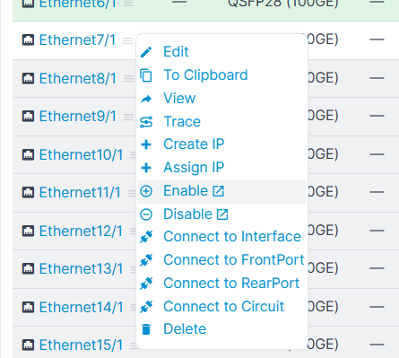
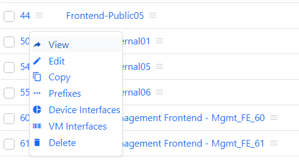
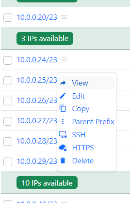

# netbox_contextmenus
Add context buttons to the links, making navigating in NetBox less clicky







The menu items can easliy be personalised

## INSTALLATION

- install as a any regular plugin.  See  [https://netboxlabs.com/docs/netbox/plugins/installation/](https://netboxlabs.com/docs/netbox/plugins/installation/)
- PyPi Packagename is 'netbox-contextmenus'.
- NetBox packagename is 'netbox_contextmenus'.
- restart the NetBox service

NBCM is compatible with NetBox v3 and v4.0 (tested upto v4.5)

---
### IMPORTANT NOTE !
NBCM version <= 1.4.3 used the 'BOTTOM_BANNER' variable to inject the javascript.

As of v1.4.4, the javascript is injected using django middleware.
Make sure to remove the setting from the ConfigRevision BOTTOM_BANNER or from your configuration.py
The nbcm.js file located in /opt/netbox/netbox/netbox/scripts can be removed.

This is a preparation to create a GUI to modifiy the Contect Menu items

---

## CONFIGURATION
These settings can be customized using the PLUGINS_CONFIG variable in 'configuration.py'
```
PLUGINS_CONFIG = {
    'netbox_contextmenus': {
        'nbcmopendelay': 150,
        'hideburgers' : 0
    }
}
```
| variable | default | function |
| --- | --- | --- |
| nbcmopendelay | 150 | Time in milliseconds that the opening of the contextmenu will be delayed |
| hideburgers | 0 | Hide the burger icon, but open the menu when hovering over a link. Works best when the nbcmopendelay is set to 500 |
